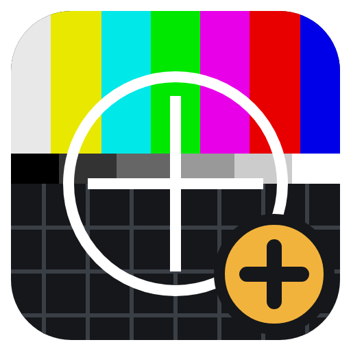

<p align="center"></p>

# Test Pattern+ for disguise Designer

A test pattern plugin for disguise Designer. It does what Designer's TestPattern layer does, plus
LED wall maps, gradients, presets and exports. Everything runs from the project's `plugins` folder;
no bridge or extra software is needed.

## Install

1. Download **`testpattern-plus-<version>.zip`** from [Releases](../../releases). Use that file,
   not GitHub's "Source code" zips.
2. Unzip it into your Designer project's `plugins` folder, so you end up with
   `<project>\plugins\testpattern-plus\`.
3. In Designer, open **Plugins → Plugin Launcher → Test Pattern+**.

**Updating:** unzip the new version over the old one, then close the plugin window and open it
again. Updates replace only the plugin's own files; your logos, presets and
`my_led_products.csv` are never touched.

## What it does

**Three modes, one click apart:** Projector grid, LED wall and Gradient.

- **Live on stage:** creates a Web layer at the playhead and updates it as you drag sliders.
  Each layer remembers its own settings.
- **Projector grid:** grid and sub-grid, circles and corner circles, centre cross, diagonals,
  border, label and resolution, logos. Line thickness, colour and size for every element.
- **LED wall:** tile size and count, half-tile row, alternating LED modules, grid refs (A1 / 1A)
  or sequence numbers (snake order, any start corner), data-port runs with arrows, tile pixel
  positions. Twelve colour modes, including rainbows, distinct colours and a rainbow inside each
  tile to spot rotated or mirrored tiles.
- **LED products:** pick a product from a searchable list to fill in tile size and modules.
  The wall size shows in pixels and metres.
- **Gradient:** greyscale and rainbow ramps or steps, 8- or 10-bit, in any direction, with
  step values labelled. Every pixel is an exact code value, with no dithering.
- **Export:** Save PNG or TIF straight into the project's media. 10-bit gradients are saved as
  16-bit files holding the exact 10-bit values.
- **Presets:** saved as files, so you can copy them between projects.
- **Input transform:** exposure, gamma and contrast on the grid and LED patterns.

## Your files in the plugin folder

| File / folder | What it is |
| --- | --- |
| `logos\` | PNG, JPEG, WebP or SVG images for the logo dropdowns |
| `presets\` | Saved presets, one `.json` each. Copy one into another project's `presets\` folder to use it there |
| `led_products.csv` | The built-in LED product list (replaced by updates) |
| `my_led_products.csv` | Optional: your own products, with the same columns. Same name replaces a built-in one, and yours show with ★. Edit in Excel, save as CSV, then press ↻ in the plugin window |

Exports go to `<project>\objects\VideoFile\test patterns+\`.

## Notes

- The preview and Web layers are 8-bit sRGB; use the 16-bit exports for 10-bit tests.
- The built-in product specs, apart from ROE Carbon CB3, should be checked against the
  manufacturer's datasheets.

## Building from source

Needs Python 3 and Node 18 or later.

```
python build.py                                # -> dist/testpattern-plus/
python build.py --install "<project>\plugins"  # build, copy into a project, byte-check
python build.py --zip                          # build the release zip
npm install && npx playwright install chromium # once, for the tests
python tests/run_tests.py                      # end-to-end tests against a fake Designer
```

Pushing a tag `v<version>` (matching `VERSION` in `build.py`) builds the zip and publishes a
GitHub Release. See `CLAUDE.md` for how the plugin talks to Designer.
